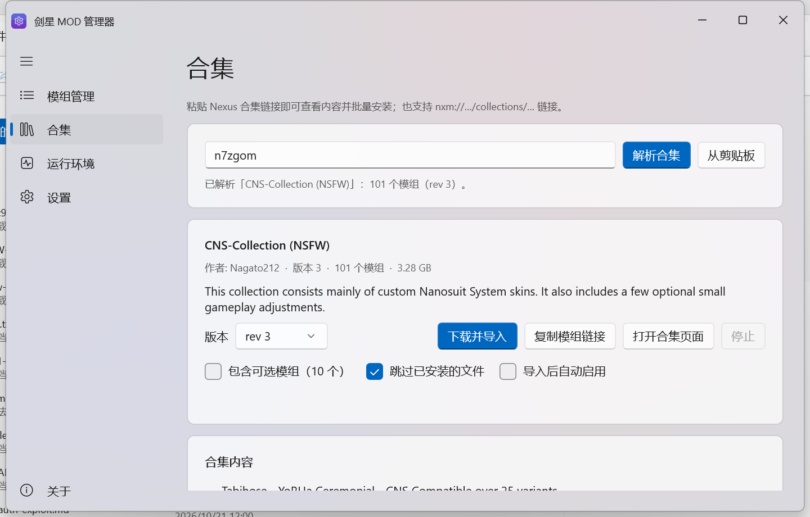

# 剑星 MOD 管理器（SB Mod Manager）

一个用 **WinUI 3 + .NET 8 + Windows App SDK 1.8** 写的《Stellar Blade（剑星）》模组管理器。
原生 Fluent / Mica 界面，支持亮暗主题，所有操作都有中文说明。
当前版本 **v1.4.4**：界面统一为 Windows 设置风格（分组卡片、统一 Mica 背景、页面滑入动画、滚动条自动隐藏、列表/详情可拖动分隔条、通知滑入滑出动画）；包含「本地安装」合集、内置 7z/RAR 解压、UE4SS 一键安装、更新检查、多版本管理、标签/备注、CNS 适配、冲突链分析与加载顺序。




## 功能

- **自动检测游戏**：读取 Steam 注册表与 `libraryfolders.vdf`，按 AppID `3489700` 找到游戏目录；也可手动选择。
- **导入模组**：压缩包（`.zip` / `.7z` / `.rar`）、文件夹、或直接选 `.pak/.ucas/.utoc`；**7z/RAR 由内置 SharpCompress 引擎解压，无需安装 7-Zip**；支持把文件/文件夹直接拖进窗口。
- **Nexus 合集**：侧边栏「合集」页粘贴链接（或 `nxm://…/collections/…`）即可浏览合集内容、切换版本、只下必需/包含可选、跳过已安装、批量下载导入并自动加标签；支持最近解析、已安装合集筛选；免费账号可一键复制所有模组页面链接。
- **本地安装合集**：自己导入的模组会自动归入内置的「本地安装」合集；首次启动会把升级前没有合集标签的旧模组一次性迁移进去；在合集页对任意合集点「启用」会停用其它合集的模组，点「停用」则移除该合集，方便在别人的合集和自己的模组之间来回切换。
- **UE4SS 一键安装**：在「运行环境」里直接下载 [Chrisr0/RE-UE4SS](https://github.com/Chrisr0/RE-UE4SS) 的最新 Release，
  自动解压、识别为运行库并部署到 `SB\Binaries\Win64`，也可以检查本地安装版本。
- **模组更新检查**：配置 Nexus API Key 后，可对带 Nexus 模组 ID 的模组一键检查更新。
- **多版本管理**：同名模组的多个版本会归入同一组，详情面板用「已安装版本」下拉切换，启用一个版本会自动停用同组其它版本。
- **标签与备注**：每个模组可自定义标签和备注，列表中直接显示标签，可按标签搜索。
- **CNS 适配**：`.dekcns.json` / `.dekani.json` 会被识别为 CNS 外观模组，自动部署到
  `SB\Content\Paks\~mods\CustomNanosuitSystem\` 下并保留 Animations / Cosmetics 目录结构。
- **冲突链分析**：一键查看所有被多个已启用模组写入的文件，按加载顺序显示「A → B」覆盖链，
  并标出高冲突模组（默认冲突 ≥ 3 个文件，可在配置里调整阈值）。
- **加载顺序**：每个模组有加载优先级，可用 ↑/↓ 调整；「按加载顺序重建部署」会按顺序重新部署，
  后面的模组覆盖前面的同名文件。
- **nxm:// 接管**：可在设置里临时接管 Nexus 的「Mod Manager Download」链接（替代 Vortex），
  收到链接后解析并尝试下载导入；关闭时恢复原来的处理程序。
- **自动识别类型**，并部署到正确位置：

  | 类型 | 判定依据 | 部署位置 |
  | --- | --- | --- |
  | PAK 内容模组 | 含 `.pak` / `.ucas` / `.utoc` | `SB\Content\Paks\~mods\`（扁平化） |
  | 散装资源模组 | 只有 json / 贴图等散装文件（如 DEK CNS） | `SB\Content\Paks\~mods\<模组名>\` |
  | UE4SS 运行库 | 含 `dwmapi.dll` 或 `ue4ss\` | `SB\Binaries\Win64\` |
  | UE4SS 脚本模组 | 含 `scripts\main.lua` | `SB\Binaries\Win64\ue4ss\Mods\<模组名>\`（自动补 `enabled.txt`） |
  | INI 配置 | 全部是 `.ini` | `%LOCALAPPDATA%\SB\Saved\Config\WindowsNoEditor\` |

- **启用 / 停用**：开关一键部署或移除文件，保存部署清单，停用后不残留。
- **硬链接部署**：库与游戏在同一磁盘时默认用硬链接，几乎瞬间完成且不额外占空间；跨盘自动回退为复制。
- **冲突检测**：目标文件已被其它模组占用时列出冲突文件，可选择强制覆盖。
- **外部文件扫描**：把 `~mods` 中不是本工具部署的文件（Vortex / 手动安装）单独列出，可定位或删除。
- **批量操作**：全部启用 / 全部停用；搜索过滤；右键菜单；详情面板显示每个文件将部署到哪里。
- **WinUI 原生窗口框**：内容延伸到标题栏（`ExtendsContentIntoTitleBar`），自绘应用图标 + 标题 + 汉堡按钮，
  系统最小化/最大化/关闭按钮透明化并跟随明暗主题换色；窗口背景使用 **Mica**（不支持时回退为主题色）。
- **更多**：通过 Steam 启动游戏、打开游戏目录 / `~mods` / 模组库 / 配置目录 / 日志、游戏安装校验、主题切换。

| 设置 | 运行环境 |
| --- | --- |
|  |  |

浅色主题下标题栏、系统按钮与 Mica 背景也会同步切换：


## 运行

直接双击：

```
SBModManager.exe
```

- 需要系统安装 **Windows App Runtime 1.8**（64 位）。本机已安装；换机器时如提示缺少运行时，
  安装 [Windows App SDK 1.8 Runtime](https://learn.microsoft.com/windows/apps/windows-app-sdk/downloads) 即可。
- 解压 7z/RAR 不再需要安装 7-Zip；加密压缩包需要密码的场景暂不支持。
- **默认以管理员身份运行**：为避免写入游戏目录或读取受保护目录被拒绝，启动时会通过 UAC 请求管理员权限。
  不需要的话可以在「设置 → 网络与集成」关闭「启动时请求管理员权限」，或启动时加 `--no-elevate`。
- 应用数据默认在 `%LOCALAPPDATA%\SBModManager`。如果该目录不可写（例如被安全软件拦截），
  会按顺序自动退回：`%USERPROFILE%\SBModManager` → exe 旁的 `SBMM-Data` → `%TEMP%\SBModManager`，
  并在设置页显示实际使用的数据目录。也可以显式指定：

  ```powershell
  .\SBModManager.exe --data-dir "D:\SBMM-Data"
  # 或设置环境变量 SBMM_DATA_DIR
  ```

  > 真正失败时也会弹出错误框并写入 `crash.log`，不会再无提示退出。

## UE4SS / Nexus 集成说明

- UE4SS 下载地址固定为 [Chrisr0/RE-UE4SS](https://github.com/Chrisr0/RE-UE4SS) 的最新 Release，
  自动跳过 `zDEV`、`zCustomGameConfigs`、`zMapGen` 等辅助压缩包，只取标准 UE4SS zip。
- 更新检查与 nxm:// 下载需要 **Nexus API Key**：在 <https://www.nexusmods.com/users/myaccount?tab=api>
  生成 Personal API Key 后填入「设置 → 网络与集成」。
- **免费账号也能直连下载**：Nexus 的 `download_link` 接口接受 nxm 链接自带的 `key`/`expires` 一次性授权参数，
  这与 Vortex 的做法一致（见 [Vortex nxmProtocol.ts](https://github.com/Nexus-Mods/Vortex/blob/master/src/renderer/src/extensions/nexus_integration/nxmProtocol.ts) 与
  [node-nexus-api Nexus.ts](https://github.com/Nexus-Mods/node-nexus-api/blob/master/src/Nexus.ts)）。
  只有**不带 key 的 nxm 链接**才需要 Premium；这类链接会回退到「打开 Nexus 页面手动下载」。
- `nxm://` 接管是本地 HKCU 协议注册，可随时关闭并恢复原处理程序。

## 从源码编译

环境：.NET SDK 8/9/10/11 均可，Windows 10 1809+，x64。

```powershell
.\build.ps1
```

脚本会：

1. 首次运行时用 `tools\fetch_nuget.py` 把 Windows App SDK 依赖下载到仓库内的 `_nuget\feed`
   （离线包源，不污染全局 NuGet 缓存）。
2. `dotnet build` 生成 Release（框架依赖模式）。
3. 把产物复制到 `dist\SBModManager`，顺手清掉空目录、保留 exe 旁已有的 `SBMM-Data`。

仓库自带 `NuGet.config`，包源指向 `_nuget\feed`、全局包目录指向 `_nuget\packages`，
因此编译不需要联网（前提是 feed 已准备好）。

### 编译注意事项（本机环境特有）

- `Microsoft.Windows.SDK.BuildTools` 自带的 `MakePri.exe` 在本机会以 `E_ACCESSDENIED` 失败，
  因此 `build.ps1` 自动把 `MakePriExeFullPath` 指向已安装 Windows SDK 里的 `makepri.exe`；
  `csproj` 里也有同样的兜底。
- 只引用 `Microsoft.WindowsAppSDK.WinUI` + `Microsoft.WindowsAppSDK.Runtime`，
  不要用元包 `Microsoft.WindowsAppSDK`，否则会把 AI/ML/Widgets 等一整套运行库带进输出。
- XAML 里 **不要**让 `x:Name` 与 `x:Bind` 的属性名重名（例如本项目的 `StatusLineText`）。
  重名时 XAML 编译器只会抛一个无法读懂的 `WMC9999`。
- 入口点使用自定义 `Program.Main`（`DISABLE_XAML_GENERATED_MAIN`），启动异常写入 `crash.log`，
  避免 WinUI 的静默 `0xC000027B` 崩溃。

## 目录结构

```
stellar-mod-manager/
├── build.ps1                  # 一键编译
├── NuGet.config               # 指向本地离线包源
├── src/SBModManager/
│   ├── Program.cs             # 自定义入口、--data-dir / --selftest / --screenshot
│   ├── App.xaml(.cs)          # 启动、致命错误弹窗、截图模式
│   ├── MainWindow.xaml(.cs)   # NavigationView 外壳
│   ├── Models/Models.cs       # ModRecord / AppConfig / DeployState
│   ├── Services/
│   │   ├── AppPaths.cs        # 数据目录探测（多级回退）与日志
│   │   ├── AppState.cs        # 配置、库、部署状态
│   │   ├── GameLocator.cs     # Steam 检测、启动游戏
│   │   ├── ArchiveService.cs  # zip / 7z / rar 解压
│   │   ├── ModImporter.cs     # 类型识别与导入
│   │   ├── ModStore.cs        # 模组库读写
│   │   ├── Deployer.cs        # 部署 / 撤销 / 冲突 / 外部扫描 / 硬链接
│   │   └── SelfTest.cs        # --selftest 自动化验证
│   └── Views/                 # ModsPage / SettingsPage / RuntimePage / AboutPage
├── tools/fetch_nuget.py       # 离线依赖下载（递归解析 nuspec）
└── docs/screenshots/
```

## 验证

核心逻辑可无界面自检（导入 → 部署 → 校验 → 撤销 → 清理）：

```powershell
# 指向一个测试用游戏目录（含 SB.exe 与 SB\Content\Paks）后：
.\SBModManager.exe --selftest selftest.txt
```

自检覆盖：PAK 导入/部署/停用、散装资源模组、CNS 外观模组（`CustomNanosuitSystem` 路径）、UE4SS 脚本模组、
版本分组键、nxm:// 链接解析、同名文件冲突链与高冲突统计、外部文件扫描。

界面截图 / 回归：

```powershell
.\SBModManager.exe --screenshot shot.png --page settings
```

`--page` 支持 `mods` / `runtime` / `settings` / `about`。

## Nexus 合集支持

- 解析：输入 `https://www.nexusmods.com/games/stellarblade/collections/<slug>` 或 slug，读取合集名、作者、版本、模组列表与可选标记（公开 GraphQL，不需要 API Key）。
- 下载：需要 Nexus API Key；Nexus 的直链接口通常要求 **Premium** 账号，免费账号可以「复制模组链接」后逐个手动下载再导入。
- 导入：按合集列表顺序逐个下载、解压、导入，模组会自动带上 `合集:<名称>` 标签和来源备注，可按标签筛选。
- 合集页：可切换历史版本、只下必需/包含可选、跳过已安装、导入后自动启用、最近解析、按「合集:名称」标签筛选已安装模组。
- 内置「本地安装」合集：手动导入的模组自动打上 `合集:本地安装` 标签；合集页「启用/停用」可在本地模组与任意他人合集之间切换（启用一个合集时会停用其它合集）。
- 暂不处理：FOMOD 选项、合集补丁、集合作者定义的加载顺序；需要精细选项时请用 Vortex 安装这些部分。

## 界面布局

- 标题栏左侧是「返回」按钮：只有存在可返回的上级页面时才显示，否则隐藏。
- 展开/收起导航的汉堡按钮位于导航栏内部顶部（类似 Windows 任务管理器），不再占用标题栏。
- 运行环境 / 设置 / 合集页采用 Windows 设置风格：分组标题 + 圆角卡片 + 左侧图标 + 右侧控件。
- 标题栏、侧边栏、内容区共用同一 Mica 背景，无硬分隔线。
- 页面切换时内容从下往上滑入并淡入；滚动条闲置 1 秒后自动淡出。
- 模组列表与详情面板之间有可拖动分隔条（宽度会记住，双击复位）。
- 顶部通知（InfoBar）滑入/滑出，底部状态文字更新时有轻微淡入。

## 第三方组件

- [Windows App SDK / WinUI 3](https://github.com/microsoft/WindowsAppSDK)（MIT）
- [SharpCompress](https://github.com/adamhathcock/sharpcompress)（MIT）：内置 7z / RAR / ZIP 解压，无外部依赖
- Segoe Fluent Icons 字体图标（系统自带）

## 作者

1. **[xiangfa-test](https://github.com/xiangfa-test)**（作者 / Author）
2. **[DeepSeek](https://github.com/deepseek-ai)**（辅助开发 / Development assistant）

## 已知限制

- 冲突检测以“目标文件路径”为单位；PAK 之间更深层的资源覆盖由游戏加载顺序决定，本工具不做 pak 合并。
- 7z / RAR / ZIP 由内置 SharpCompress 引擎解压，**不需要安装 7-Zip**；带密码的压缩包暂不支持（会提示用外部 7-Zip）。
- 只负责“文件部署”这一层；启用/停用前建议先退出游戏，避免文件被占用。
- 以管理员身份运行时，文件选择使用 Win32 通用对话框；从资源管理器**拖拽**文件到提权窗口会被 Windows（UIPI）阻止，需要拖拽时请关闭管理员模式（设置里可关）。
- Nexus 更新检查只对通过 nxm:// 导入且带模组 ID 的模组有效；从普通 zip 导入的模组没有 ID，只能手动检查。
- 不带 `key` 的 nxm 链接只有 Premium 能取直链；从网页「Mod Manager Download」得到的链接都带 key，免费账号可用。
- Nexus 合集批量下载需要 Premium；暂不支持合集里的 FOMOD 选项与补丁。
- 仅支持 Windows x64。
