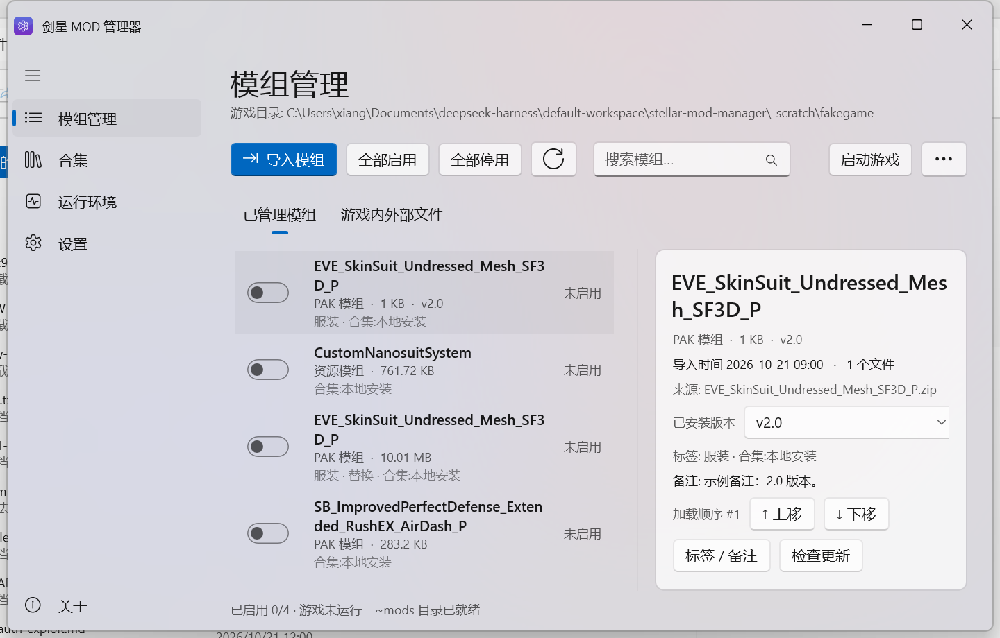
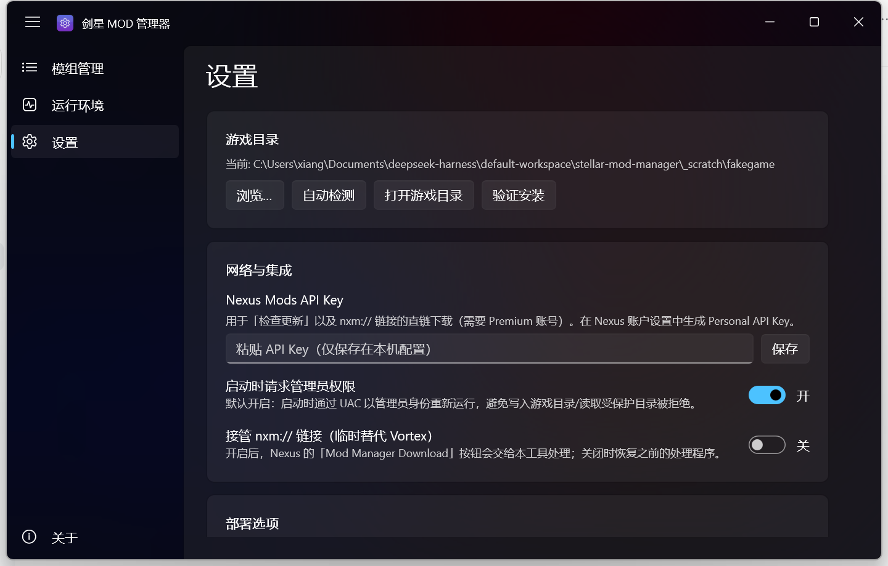
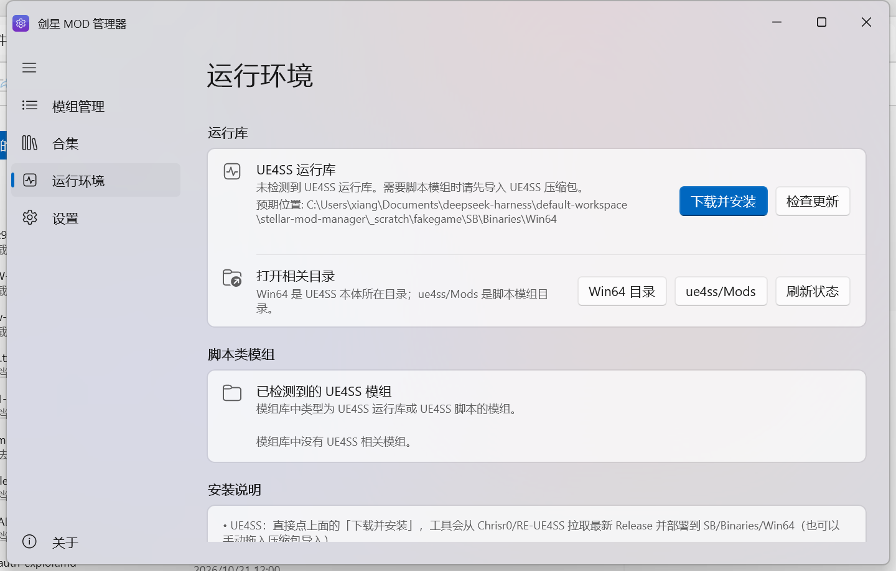
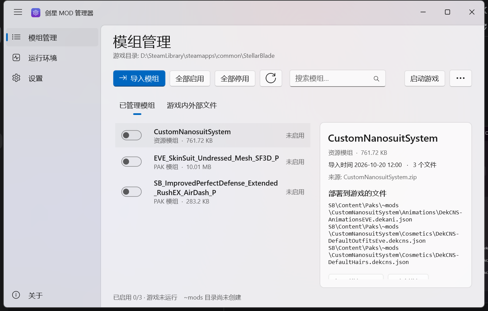

# 剑星 MOD 管理器（SB Mod Manager）

一个用 **WinUI 3 + .NET 8 + Windows App SDK 1.8** 写的《Stellar Blade（剑星）》模组管理器。
原生 Fluent / Mica 界面，支持亮暗主题，所有操作都有中文说明。



## 功能

- **自动检测游戏**：读取 Steam 注册表与 `libraryfolders.vdf`，按 AppID `3489700` 找到游戏目录；也可手动选择。
- **导入模组**：压缩包（`.zip` / `.7z` / `.rar`）、文件夹、或直接选 `.pak/.ucas/.utoc`；支持把文件/文件夹直接拖进窗口。
- **自动识别类型**，并部署到正确位置：

  | 类型 | 判定依据 | 部署位置 |
  | --- | --- | --- |
  | PAK 内容模组 | 含 `.pak` / `.ucas` / `.utoc` | `SB\Content\Paks\~mods\`（扁平化） |
  | 散装资源模组 | 只有 json / 贴图等散装文件（如 DEK CNS） | `SB\Content\Paks\~mods\<模组名>\` |
  | UE4SS 运行库 | 含 `dwmapi.dll` 或 `ue4ss\` | `SB\Binaries\Win64\` |
  | UE4SS 脚本模组 | 含 `scripts\main.lua` | `SB\Binaries\Win64\ue4ss\Mods\<模组名>\`（自动补 `enabled.txt`） |
  | INI 配置 | 全部是 `.ini` | `%LOCALAPPDATA%\SB\Saved\Config\WindowsNoEditor\` |

- **启用 / 停用**：开关一键部署或移除文件，保存部署清单，停用后不残留。
- **硬链接部署**：库与游戏在同一磁盘时默认用硬链接，几乎瞬间完成且不额外占空间；跨盘自动回退为复制。
- **冲突检测**：目标文件已被其它模组占用时列出冲突文件，可选择强制覆盖。
- **外部文件扫描**：把 `~mods` 中不是本工具部署的文件（Vortex / 手动安装）单独列出，可定位或删除。
- **批量操作**：全部启用 / 全部停用；搜索过滤；右键菜单；详情面板显示每个文件将部署到哪里。
- **WinUI 原生窗口框**：内容延伸到标题栏（`ExtendsContentIntoTitleBar`），自绘应用图标 + 标题 + 汉堡按钮，
  系统最小化/最大化/关闭按钮透明化并跟随明暗主题换色；窗口背景使用 **Mica**（不支持时回退为主题色）。
- **更多**：通过 Steam 启动游戏、打开游戏目录 / `~mods` / 模组库 / 配置目录 / 日志、游戏安装校验、主题切换。

| 设置 | 运行环境 |
| --- | --- |
|  |  |

浅色主题下标题栏、系统按钮与 Mica 背景也会同步切换：



## 运行

直接双击：

```
dist\SBModManager\SBModManager.exe
```

- 发行包 **36 MB / 39 个文件**（Microsoft.WinUI + WinUI 依赖 + Windows SDK 投影），
  不再包含 AI / ML / Widgets / onnxruntime / DirectML 等无关运行库，也没有几十个空的语言目录。
- 需要系统安装 **Windows App Runtime 1.8**（64 位）。本机已安装；换机器时如提示缺少运行时，
  安装 [Windows App SDK 1.8 Runtime](https://learn.microsoft.com/windows/apps/windows-app-sdk/downloads) 即可。
- 应用数据默认在 `%LOCALAPPDATA%\SBModManager`。如果该目录不可写（例如被安全软件拦截），
  会按顺序自动退回：`%USERPROFILE%\SBModManager` → exe 旁的 `SBMM-Data` → `%TEMP%\SBModManager`，
  并在设置页显示实际使用的数据目录。也可以显式指定：

  ```powershell
  .\SBModManager.exe --data-dir "D:\SBMM-Data"
  # 或设置环境变量 SBMM_DATA_DIR
  ```

  > 之前版本“双击没反应”就是因为数据目录创建被拒绝后直接静默崩溃；现在会逐级探测可用目录，
  > 真正失败时也会弹出错误框并写入 `crash.log`，不会再无提示退出。

## 从源码编译

环境：.NET SDK 8/9/10/11 均可，Windows 10 1809+，x64。

```powershell
.\build.ps1
```

脚本会：

1. 首次运行时用 `tools\fetch_nuget.py` 把 Windows App SDK 依赖下载到仓库内的 `_nuget\feed`
   （离线包源，不污染全局 NuGet 缓存）。
2. `dotnet build` 生成 Release（框架依赖模式）。
3. 把产物复制到 `dist\SBModManager`，顺手清掉空目录、保留 exe 旁已有的 `SBMM-Data`。

仓库自带 `NuGet.config`，包源指向 `_nuget\feed`、全局包目录指向 `_nuget\packages`，
因此编译不需要联网（前提是 feed 已准备好）。

### 编译注意事项（本机环境特有）

- `Microsoft.Windows.SDK.BuildTools` 自带的 `MakePri.exe` 在本机会以 `E_ACCESSDENIED` 失败，
  因此 `build.ps1` 自动把 `MakePriExeFullPath` 指向已安装 Windows SDK 里的 `makepri.exe`；
  `csproj` 里也有同样的兜底。
- 只引用 `Microsoft.WindowsAppSDK.WinUI` + `Microsoft.WindowsAppSDK.Runtime`，
  不要用元包 `Microsoft.WindowsAppSDK`，否则会把 AI/ML/Widgets 等一整套运行库带进输出。
- XAML 里 **不要**让 `x:Name` 与 `x:Bind` 的属性名重名（例如本项目的 `StatusLineText`）。
  重名时 XAML 编译器只会抛一个无法读懂的 `WMC9999`。
- 入口点使用自定义 `Program.Main`（`DISABLE_XAML_GENERATED_MAIN`），启动异常写入 `crash.log`，
  避免 WinUI 的静默 `0xC000027B` 崩溃。

## 目录结构

```
stellar-mod-manager/
├── build.ps1                  # 一键编译
├── NuGet.config               # 指向本地离线包源
├── src/SBModManager/
│   ├── Program.cs             # 自定义入口、--data-dir / --selftest / --screenshot
│   ├── App.xaml(.cs)          # 启动、致命错误弹窗、截图模式
│   ├── MainWindow.xaml(.cs)   # NavigationView 外壳
│   ├── Models/Models.cs       # ModRecord / AppConfig / DeployState
│   ├── Services/
│   │   ├── AppPaths.cs        # 数据目录探测（多级回退）与日志
│   │   ├── AppState.cs        # 配置、库、部署状态
│   │   ├── GameLocator.cs     # Steam 检测、启动游戏
│   │   ├── ArchiveService.cs  # zip / 7z / rar 解压
│   │   ├── ModImporter.cs     # 类型识别与导入
│   │   ├── ModStore.cs        # 模组库读写
│   │   ├── Deployer.cs        # 部署 / 撤销 / 冲突 / 外部扫描 / 硬链接
│   │   └── SelfTest.cs        # --selftest 自动化验证
│   └── Views/                 # ModsPage / SettingsPage / RuntimePage / AboutPage
├── tools/fetch_nuget.py       # 离线依赖下载（递归解析 nuspec）
└── docs/screenshots/
```

## 验证

核心逻辑可无界面自检（导入 → 部署 → 校验 → 撤销 → 清理）：

```powershell
# 指向一个测试用游戏目录（含 SB.exe 与 SB\Content\Paks）后：
.\SBModManager.exe --selftest selftest.txt
```

自检覆盖：PAK 导入/部署/停用、散装资源模组、UE4SS 脚本模组、外部文件扫描。

界面截图 / 回归：

```powershell
.\SBModManager.exe --screenshot shot.png --page settings
```

`--page` 支持 `mods` / `runtime` / `settings` / `about`。

## 作者

1. **xiangfa-test**（作者 / Author）— https://github.com/xiangfa-test
2. **DeepSeek**（辅助开发 / Development assistant）

项目主页: https://github.com/xiangfa-test/Stellar-Blade-Mod-Manager

## 已知限制

- 冲突检测以“目标文件路径”为单位；PAK 之间更深层的资源覆盖由游戏加载顺序决定，本工具不做 pak 合并。
- `.rar` / `.7z` 解压需要系统装有 7-Zip 或 Bandizip（会自动寻找常见安装路径）。
- 只负责“文件部署”这一层；启用/停用前建议先退出游戏，避免文件被占用。
- 仅支持 Windows x64。
